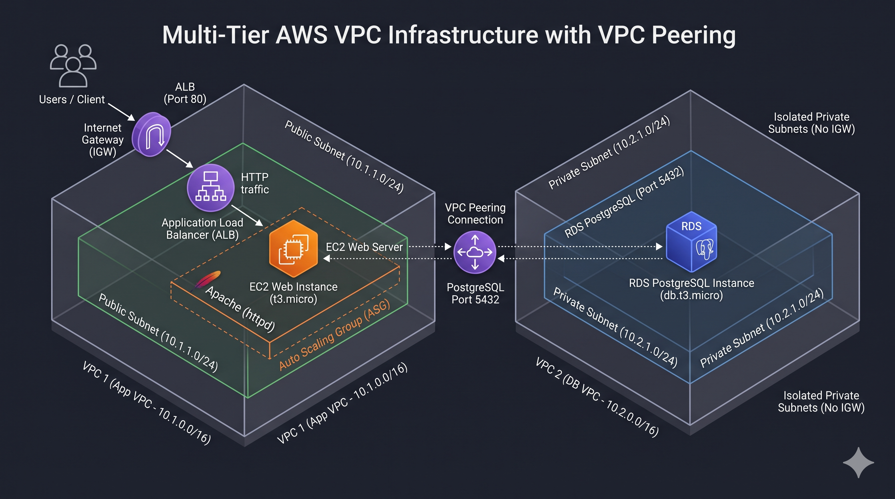

# Enterprise Multi-Tier AWS VPC Infrastructure with VPC Peering

[](https://www.terraform.io/)
[](https://aws.amazon.com/)
[](https://opensource.org/licenses/MIT)

A resilient, multi-tier AWS network and compute topology provisioned entirely via Infrastructure as Code (Terraform). 

This project demonstrates production-style network isolation by separating the public-facing application tier from a zero-internet private database tier across two isolated Virtual Private Clouds (VPCs), interconnected securely via an AWS VPC Peering Connection.

---

## 🏛️ Architecture Overview

The infrastructure decouples compute and data layers into discrete network boundaries, eliminating public attack vectors to the database tier while retaining private, line-rate throughput across AWS's global network backbone.

```
                                  [ Internet / Users ]
                                           |
                                           | HTTP (Port 80)
                                           v
+---------------------------------------------------------------------------------------+
|  VPC 1: Application Tier (10.1.0.0/16) - "app-vpc"                                    |
|                                                                                       |
|   +-----------------------+              +-----------------------------------------+  |
|   | Public Subnet (AZ A)  |              | Public Subnet (AZ B)                    |  |
|   | 10.1.1.0/24           |              | 10.1.3.0/24                             |  |
|   |                       |              |                                         |  |
|   |  +-----------------+  |              |  +-----------------+                    |  |
|   |  | ALB Node (AZ A) |<-+--------------+--| ALB Node (AZ B) | (External ALB)    |  |
|   |  +--------+--------+  |              |  +-----------------+                    |  |
|   |           |           |              +-----------------------------------------+  |
|   |           v           |                                                           |
|   |  +-----------------+  |                                                           |
|   |  | EC2 (t3.micro)  |  |                                                           |
|   |  | Apache Web App  |  | (Auto Scaling Group Managed)                             |
|   |  +--------+--------+  |                                                           |
|   +-----------|-----------+                                                           |
+---------------|-----------------------------------------------------------------------+
                |
                | PostgreSQL (Port 5432) over VPC Peering (pcx-*)
                v
+---------------------------------------------------------------------------------------+
|  VPC 2: Database Tier (10.2.0.0/16) - "db-vpc"                                        |
|  [ ZERO Internet Gateway / NAT - Fully Air-Gapped from Public Internet ]             |
|                                                                                       |
|   +------------------------------------+   +------------------------------------+     |
|   | Private Subnet (AZ A) 10.2.1.0/24  |   | Private Subnet (AZ B) 10.2.2.0/24  |     |
|   |                                    |   |                                    |     |
|   |    +--------------------------+    |   |    (Standby Subnet for Multi-AZ)   |     |
|   |    | RDS PostgreSQL 15        |    |   |                                    |     |
|   |    | (db.t3.micro)            |<---+---+                                    |     |
|   |    +--------------------------+    |   |                                    |     |
|   +------------------------------------+   +------------------------------------+     |
+---------------------------------------------------------------------------------------+
```

### Architectural Highlights
* **Public Web Tier (`10.1.0.0/16`):** An Application Load Balancer spans across Availability Zones (`us-east-1a` and `us-east-1b`) targeting an Auto Scaling Group running EC2 instances with Amazon Linux 2023.
* **Air-Gapped Database Tier (`10.2.0.0/16`):** Dedicated RDS DB subnet group deployed without an Internet Gateway or NAT attachments (`Network Connections: 0`).
* **Private Cross-VPC Peering:** Inter-VPC route tables route non-overlapping CIDRs (`10.1.0.0/16` $\leftrightarrow$ `10.2.0.0/16`) through a custom VPC Peering Connection (`pcx`), enforcing encrypted, private AWS backbone transit.
* **Security Group Chaining:** The EC2 web tier accepts traffic strictly from the ALB security group, and the RDS database accepts ingress on port 5432 strictly from the EC2 application security group.

---

## 🖼️ Architecture & Live Verification

### 3D Infrastructure Topology


### Live Application Load Balancer Verification
The Application Load Balancer health checks verify target readiness, while instance startup scripts validate private socket reachability across the peering link directly to the PostgreSQL instance.


*Live response displayed on the ALB endpoint:*
```text
Multi-Tier VPC Architecture Status
Deployed via Terraform | Host: ip-10-1-1-181.ec2.internal
RDS Peering Test (Port 5432): Connected successfully to dev-app-db.cxxxxxxx.us-east-1.rds.amazonaws.com
```

---

## 📂 Project Repository Structure

```tree
.
├── .gitignore               # Excludes .tfstate, credentials, and cache
├── README.md                # Project documentation and architectural overview
├── assets/
│   ├── architecture.png     # Visual topology diagram
│   └── alb-proof.png        # Screenshot of the live ALB response
├── compute_alb.tf           # ALB, Target Group, ASG, Launch Template & User Data
├── database.tf              # RDS PostgreSQL instance, Subnet Group & DB SG
├── main.tf                  # Provider definition & backend configuration
├── outputs.tf               # Exported endpoints (ALB DNS, RDS Host, VPC IDs)
├── variables.tf             # Dynamic input variables & CIDR blocks
├── vpc_app.tf               # VPC 1 networking (Subnets, IGW, Route Tables)
├── vpc_db.tf                # VPC 2 networking (Private Subnets, Route Tables)
└── vpc_peering.tf           # VPC Peering link, Requester & Accepter routes
```

---

## 🛠️ Tech Stack & Services

| Category | AWS Service / Tool | Purpose |
|---|---|---|
| **IaC** | Terraform >= 1.5 | Declarative resource provisioning and state management |
| **Networking** | VPC, Route Tables, Subnets, IGW | Dual isolated virtual networks |
| **Connectivity** | VPC Peering Connection (`pcx`) | Secure cross-VPC private communication |
| **Compute** | EC2 (`t3.micro`), Auto Scaling Group | Elastic web application instances |
| **Load Balancing** | Application Load Balancer (ALB) | Public traffic ingestion and health-check monitoring |
| **Database** | Amazon RDS (PostgreSQL 15) | Managed relational storage in isolated subnets |
| **Security** | IAM, AWS Security Groups | Stateful ingress/egress filtering with least-privilege |

---

## 🚀 Quickstart & Reproduction Guide

### Prerequisites
* [Terraform CLI](https://developer.hashicorp.com/terraform/downloads) installed locally.
* [AWS CLI](https://aws.amazon.com/cli/) configured with administrative privileges:
  ```bash
  aws sts get-caller-identity
  ```

### 1. Clone the Repository
```bash
git clone https://github.com/<YOUR-USERNAME>/aws-vpc-multitier-peering.git
cd aws-vpc-multitier-peering
```

### 2. Initialize and Validate Terraform
```bash
terraform init
terraform validate
```

### 3. Review Plan & Deploy
```bash
terraform plan -out=tfplan
terraform apply tfplan
```

### 4. Verify Active Deployment
```bash
# Print outputs
ALB_URL=$(terraform output -raw alb_dns_name)
echo "Load Balancer URL: http://$ALB_URL"

# Test response
curl -i "http://$ALB_URL"
```

### 5. Clean Teardown
To avoid ongoing charges from the Application Load Balancer and RDS instance:
```bash
terraform destroy -auto-approve
```

---

## 🔒 Security Best Practices Implemented

* **Principle of Least Privilege:** Security groups isolate services—ALB allows HTTP `80` to all, EC2 allows `80` only from the ALB, and RDS allows `5432` only from the EC2 security group.
* **Zero Direct DB Ingress/Egress:** `db-vpc` contains no Internet Gateway and no NAT Gateway; zero outbound internet leakage is possible.
* **Strict State Protection:** `.gitignore` rules prevent committing `.tfstate` files, secrets, or SSH keys to version control.
